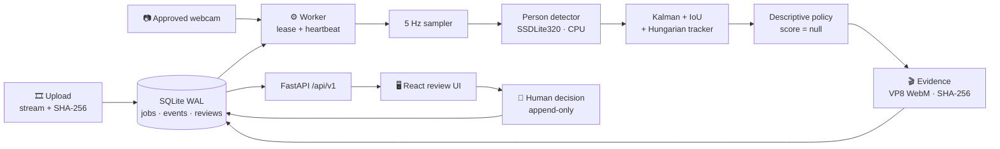
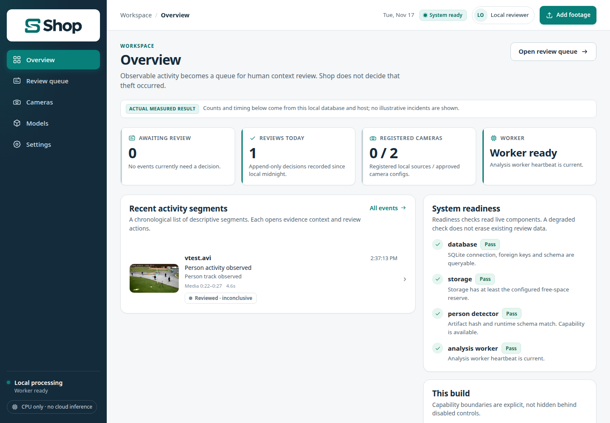
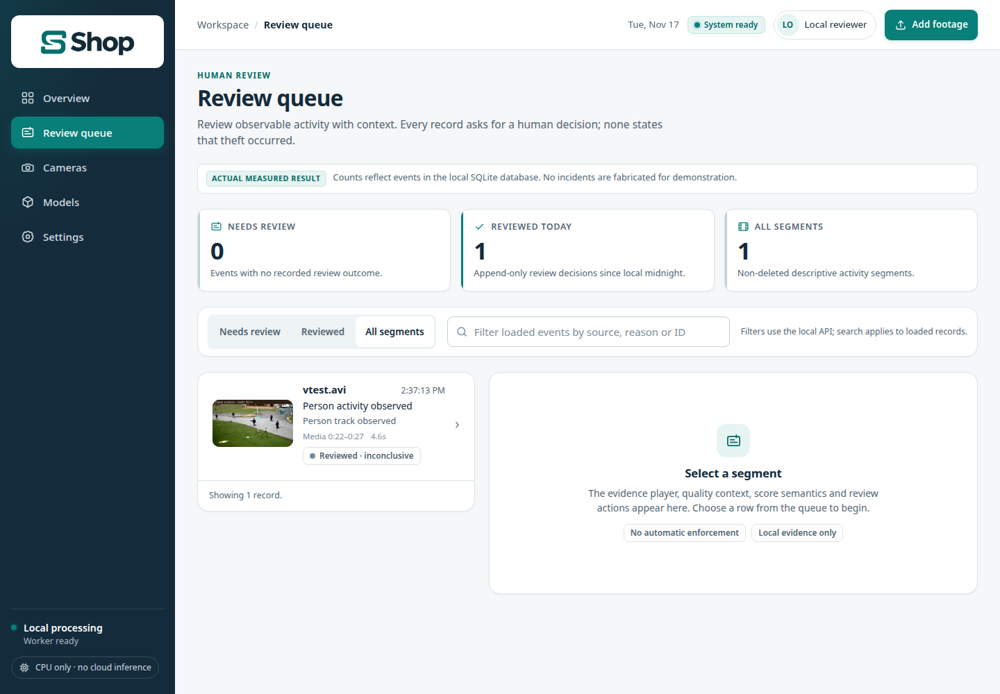
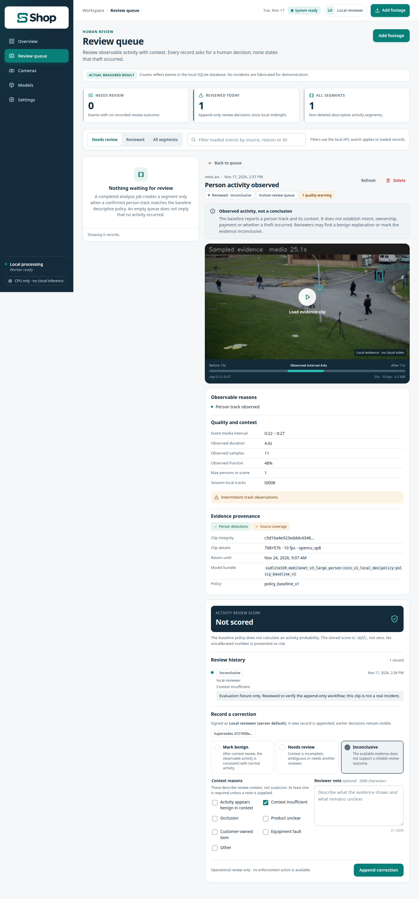
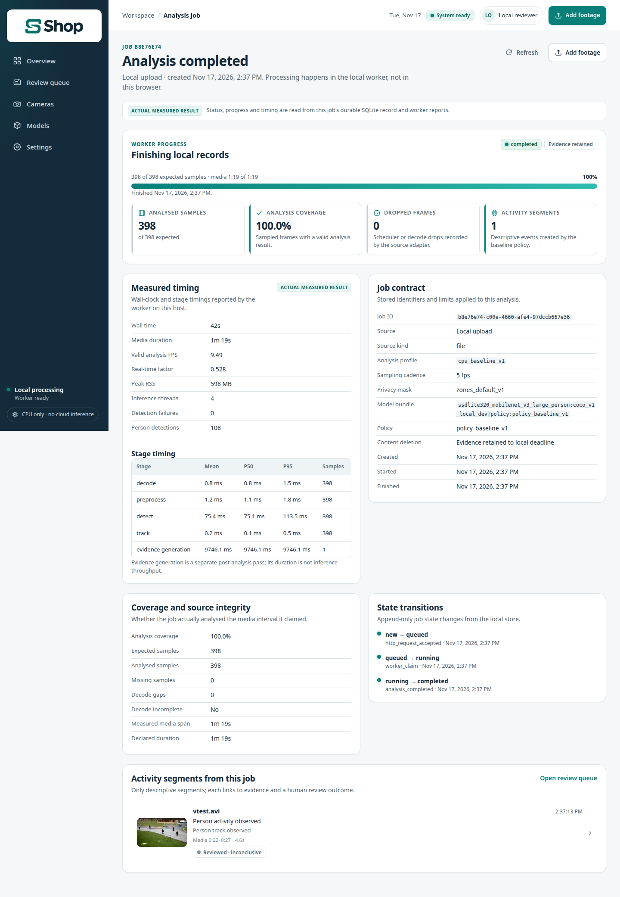
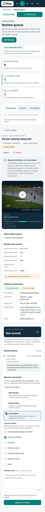

<div align="center">


<br/>

<p>
  
  
  
  
  
  
  
</p>

**Shop** turns hours of retail camera footage into a short, evidence-backed queue of
**descriptive activity segments** that a person reviews.
It runs entirely on one local CPU and never decides that theft occurred.

[The problem](#-the-problem) ·
[How it works](#-how-it-works) ·
[Product tour](#-product-tour) ·
[Quick start](#-quick-start) ·
[Status](#-status--roadmap) ·
[Docs](#-documentation)

</div>

---

## 🎯 The problem



Store teams **cannot watch every camera all the time**. Footage piles up and gets checked only after a loss
has been noticed. When an automated tool does raise an alert, it usually shows a confident label
("suspicious", "theft") with no context, which pushes staff toward conclusions the video does not support.

The same visible pattern (an item leaving view near a bag) also happens during normal shopping,
when something blocks the view, or when people handle their own belongings. A label without context is unsafe.

### What Shop solves

| Pain today | What Shop does instead |
| --- | --- |
| Reviewers must scrub through hours of continuous video | Samples video at **5 Hz on CPU**, detects and tracks people, and publishes only **short segments** worth a look |
| Black-box alerts say *"theft"* or show a risk % | Events are **descriptive only** (`person_activity_observed`). The score is stored as `null` and shown as **"Not scored"**, never as 0 % |
| Alerts arrive without context | Every segment comes with a **WebM clip that includes 10 s before and after**, burned-in track boxes, a thumbnail, quality warnings and its provenance |
| Decisions are informal and can be quietly rewritten | Reviews are **append-only** (`benign` / `review_needed` / `inconclusive`) with reason codes, correction history and an audit trail |
| Cloud video services raise privacy and cost concerns | **100 % local**: no cloud inference, no audio, no face or identity recognition, privacy masks applied before detection, retention-bound evidence |
| An empty dashboard looks like "nothing happened" | Coverage, dropped frames and worker health are shown. The UI states that an empty queue **does not mean** no activity occurred |

> [!IMPORTANT]
> Shop is a **review assistant, not an enforcement system**. Pose, wrist proximity, product visibility or someone
> leaving the frame cannot establish concealment, intent, ownership, payment or theft. No action is automated or
> recommended.

---

## ⚙️ How it works





- **Two processes, one host.** The API handles HTTP and durable state. A separate worker runs inference, so a slow model never freezes the UI, and no inference ever runs inside an HTTP request.
- **One frame contract** (`shop_frame_v1`) for files and webcams: integer-millisecond timestamps, discontinuity flags, BGR `uint8`.
- **Own tracker.** Constant-velocity Kalman filter, IoU plus elapsed-time motion cost, Hungarian assignment, tentative / confirmed / lost / removed states. Track IDs are **session-local**, never identities.
- **Evidence integrity.** Clips are hashed with SHA-256, served with HTTP Range, kept for a configurable retention period, and deletable as a local tombstone.
- **Fails closed.** A dead worker, missing checkpoint or failed evidence write produces a visible *degraded* or *unavailable* state, never a silent "all clear".

---

## 🖥️ Product tour

The review UI follows the Shop brand system: navy `#142B3B`, teal `#087F78`, amber only for *needs review*,
44 px controls, visible focus rings, and reduced-motion support. All numbers shown come from the local database.
The UI never shows fabricated incidents.

<table>
  <tr>
    <td width="50%"><br/><sub><b>Overview</b>: queue counts, worker health, readiness checks and capability boundaries</sub></td>
    <td width="50%"><br/><sub><b>Review queue</b>: Needs review / Reviewed / All tabs, search, honest empty states</sub></td>
  </tr>
  <tr>
    <td width="50%"><br/><sub><b>Event detail</b>: before/after evidence timeline, quality context, "Not scored", append-only decision form</sub></td>
    <td width="50%"><br/><sub><b>Analysis job</b>: measured coverage, dropped frames, stage latency, segments created</sub></td>
  </tr>
</table>

<details>
<summary><b>Mobile layout (390 px)</b></summary>
<br/>

</details>

### Feature checklist

- [x] Upload MP4 / MOV / WebM / MKV / AVI / M4V, with streamed SHA-256, decoder probe, size, duration and resolution gates
- [x] Register an allow-listed webcam, preview one frame, run bounded live analysis
- [x] Durable SQLite job queue, separate worker, cancellation, lease recovery, `WORKER_INTERRUPTED` fail-closed
- [x] Person detection on CPU (SSDLite320 MobileNetV3, hash-verified local checkpoint)
- [x] Session-local multi-person tracking
- [x] Descriptive events with quality and coverage evidence, and a `null` score
- [x] Evidence clips with before/after context, burned-in boxes, thumbnails and Range playback
- [x] Privacy polygons rasterised **before** detection, preview and evidence, plus an analysis ROI
- [x] Append-only human reviews with reason codes and a correction history
- [x] Optional bearer token, reviewer allow-list, request IDs, idempotency keys, ETags, audit log and retention maintenance
- [ ] Retail product detection, pose, temporal TCN *(gated: needs rights-approved labelled data)*
- [ ] RTSP, multi-camera scheduling, exports, legal hold, polygon editor *(see [Status](docs/status.md))*

---

## 🚀 Quick start

**Prerequisites:** Linux (developed on Pop!_OS), Python 3.12, Node.js 20+, any x86-64 CPU. **No CUDA is needed or used.**

```bash
git clone https://github.com/Sarthak702-droid/ShopliftingAI.git
cd ShopliftingAI

# 1. Python environment (CPU wheels first, then the project)
python3.12 -m venv .venv
.venv/bin/pip install --upgrade pip
.venv/bin/pip install -r requirements-cpu.txt
.venv/bin/pip install -e . --no-deps
.venv/bin/pip install -r requirements-dev.txt

# 2. Place the person checkpoint described in docs/models.md
#    Expected: var/models/ssdlite320_mobilenet_v3_large_coco-a79551df.pth

# 3. Build the review UI
(cd apps/web && npm ci && npm run build)

# 4. Start the API (terminal 1) and the worker (terminal 2)
.venv/bin/uvicorn shop_api.main:app --host 127.0.0.1 --port 8000
.venv/bin/python -m shop_worker
```

Open **<http://127.0.0.1:8000>**. Interactive API docs are at <http://127.0.0.1:8000/api/docs>.

On a clean checkout the API creates `var/shop.db` and applies migrations on startup. The worker never migrates.
To prepare the database explicitly, run `.venv/bin/alembic upgrade head`.

<details>
<summary><b>🔐 Optional local authentication</b></summary>

```bash
export SHOP_API_TOKEN="$(python3 -c 'import secrets; print(secrets.token_urlsafe(32))')"
.venv/bin/uvicorn shop_api.main:app --host 127.0.0.1 --port 8000
```

When `SHOP_API_TOKEN` is set, every `/api/v1` route except `/api/v1/health/*` requires
`Authorization: Bearer <token>`. The review UI asks for the token, stores it in `localStorage`, and sends it only to
the same-origin API. The reviewer identity is sent as `X-Shop-Reviewer` and must match `security.reviewers` in
`configs/shop.yaml`.

> Auth is opt-in so a single-user loopback setup works out of the box. On any shared host, set the token and put a
> TLS reverse proxy in front.
</details>

<details>
<summary><b>🧪 Verify</b></summary>

```bash
# Backend: contracts, geometry, tracking, policy, persistence, API integration
.venv/bin/python -m pytest tests -q

# Frontend: unit and interaction tests, then the production build
cd apps/web
npm test -- --run
npm run build
```

Last recorded run on this host: **84 backend tests passed**, **56 frontend tests passed**, and the production build
succeeded (57 modules; 49.45 kB CSS, 373.81 kB JS before gzip). See [Evaluation](docs/evaluation.md).
</details>

<details>
<summary><b>📡 API at a glance</b></summary>

```bash
curl -s http://127.0.0.1:8000/api/v1/health/ready | jq .status
curl -s "http://127.0.0.1:8000/api/v1/events?reviewed=false&limit=30" | jq '.items[].event_type'
```

```jsonc
{
  "event_type": "person_activity_observed",   // descriptive, never a verdict
  "reasons": ["person_track_observed"],
  "review_score": null,                        // no calibrated model, so no number
  "media_interval_ms": { "start": 22600, "end": 27200 },
  "review_state": "inconclusive"
}
```

Full contract: [docs/api.md](docs/api.md).
</details>

---

## 📊 Measured baseline

`[Actual measured result]` from one CPU run on an Intel i7-1065G7 (4 cores / 8 threads), using a public OpenCV
evaluation fixture:

| Metric | Value |
| --- | --- |
| Samples analysed | 398 / 398 at 5 Hz |
| Wall time | 41.95 s, real-time factor **0.528** (faster than real time) |
| Peak memory | ~612 MB RSS |
| Detections / tracks | 108 / 16 |
| Evidence | 25.2 s VP8 clip, browser playback verified (HTTP 200/206) |

> [!NOTE]
> These figures measure **pipeline latency and coverage only**. Detection precision/recall and event accuracy have
> **not** been measured, and no shoplifting-detection accuracy is claimed. See [Evaluation](docs/evaluation.md).

---

## 🗺️ Status & roadmap

| Phase | Scope | Status |
| --- | --- | --- |
| 0 | Environment, contracts, CPU proof | ✅ Complete |
| 1 | File ingestion, sampling, person detection, tracking | ✅ Complete baseline |
| 2 | Descriptive policy, quality, evidence | ✅ Complete baseline |
| 3 | Durable jobs, API, review UI | ✅ Complete baseline |
| 4 | Retail product detection | ⛔ Blocked: no product box labels |
| 5 | Pose | ⛔ Blocked: no approved checkpoint |
| 6 | Temporal features + TCN, calibration | 🟡 Data ready: MERL Shopping (5,377 labelled intervals); training not started |
| 7 | RTSP and multi-camera | ⏸️ Deferred |
| 8 | Exports, deletion status, legal hold | 🔜 Not implemented |
| 9 | Commercial hardening (packaging, roles, formal a11y/security) | 🔜 Not started |

Known gaps, conflicts with the PRD, and next steps are listed in [docs/status.md](docs/status.md).

---

## 🗂️ Project layout

```text
apps/api/shop_api/          FastAPI app, routes, schemas, serializers
apps/worker/shop_worker/    Durable job worker and database sink
apps/web/                   React + TypeScript + Vite review interface
packages/shop_core/         Config, contracts, sources, detection, tracking,
                            policy, evidence, persistence, pipeline
ml/manifests/               Versioned model manifests and disabled-gate records
migrations/                 Alembic schema history
configs/shop.yaml           Local CPU profile and safety limits
tests/                      Backend unit and integration tests
docs/                       Architecture, API, models, data, evaluation, runbook, status
var/                        Local runtime state (git-ignored)
```

Runtime state (SQLite DB, uploads, evidence, thumbnails, worker heartbeat) lives in `var/`. The API never returns
absolute paths.

## 📚 Documentation

| Document | Contents |
| --- | --- |
| [Architecture](docs/architecture.md) | Components, processing flow, contracts, tracking, policy, evidence, storage, failure handling |
| [API contract](docs/api.md) | Endpoints, auth, errors, idempotency, media streaming, examples |
| [Model registry](docs/models.md) | Manifests, hashes, rights, approval gates, disabled modules, feature schema |
| [Data lineage](docs/data.md) | Source-to-event lineage, database schema, retention, dataset rights status |
| [Data collection](docs/data-collection.md) | Datasets held, Google Drive layout, MERL label format, training plan |
| [Evaluation](docs/evaluation.md) | Measured CPU run, test results, browser verification, metric limits |
| [Runbook](docs/runbook.md) | Install, run, operate, back up, reset, troubleshoot |
| [Status](docs/status.md) | Delivered scope, deferred capabilities, PRD conflicts, known gaps |
| [PRD](ShopliftingAI_Comprehensive_PRD.pdf) · [ML guide](Shop_ML_Model_Selection_and_Implementation_Guide.pdf) · [Data guide](Shop_Training_and_Testing_Data_Download_Guide.pdf) | Source product, model and data-sourcing specifications |
| [Brand & UX guide](Shop-brand-UI-UX-guide.html) · [Tokens](Shop-tokens.css) | Colour, type, spacing and motion tokens used by the UI |

## ⚖️ Data, rights and safety

- **Training data.** The [MERL Shopping Dataset](https://www.merl.com/demos/merl-shopping-dataset) is stored on Google Drive: 106 overhead CCTV-style videos of 41 people in a mock grocery store, with 5,377 labelled shelf-interaction intervals (reach, retract, hand in shelf, inspect product, inspect shelf). Its licence allows **research and educational use only**, so any model trained on it stays `development_only`. See [Data collection](docs/data-collection.md).
- **Smoke-test data.** OpenCV's public `vtest.avi` exercises decoding, tracking, evidence and review. It has no labels.
- **Not acquired.** UCF-Crime, MEVA, SKU-110K, RPC, D2S, MOT17, Avenue and ShanghaiTech remain permission-gated. Own store footage, the guides' primary commercial source, has not been recorded yet.
- **Model rights.** The person detector uses COCO-derived TorchVision weights and is marked `development_only` with `approved_for_commercial_release: false`.
- **Privacy.** No audio, no biometrics, no cross-session identity. Privacy masks are applied before detection. Evidence expires according to the retention setting.
- **Vocabulary.** Events use only *person activity observed*, *review needed*, *item visibility lost*, *insufficient evidence*, *analysis unavailable* or *inconclusive*. The words *theft*, *suspect* and *guilty* never appear as system output.

<div align="center">
<br/>

<br/>
<sub>Local-first · CPU-only · Human-in-the-loop by design</sub>
</div>
