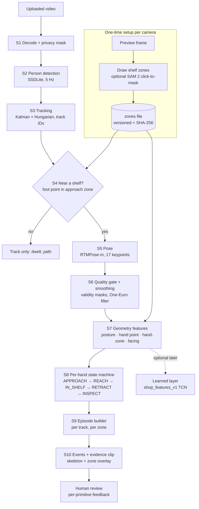

# Shelf Interaction Analyzer (SIA): algorithm design

Status: **design, not implemented**. Last updated: 18 November 2026.
Profile name when integrated: `shop_interaction_rules_v1` (research mode).

## 1. Goal

From prerecorded single-camera video, describe for each person who comes near a shelf:

1. **Who**: a session-local track ID (never an identity).
2. **Posture**: standing, bending or crouching/sitting.
3. **Hand**: where each hand is and whether it enters a specific shelf zone, for how long.
4. **Action**: reach, hand in shelf, retract, inspect product, look at shelf.
5. **Attention (coarse)**: which shelf zone the body or head is turned towards, and for how long.
6. **Evidence**: a clip with skeleton and zone overlay, and the per-step signals behind every claim.

The output is descriptive and goes to a human reviewer, as it does today.

**Non-goals:** exact eye gaze; identity; take vs put vs touch in v1 (see §11); product, bag or
concealment reasoning; any theft, intent or risk score.

Why rules on top of pretrained models instead of one end-to-end network:

- Each stage can be measured separately on public data.
- It needs no labelled training data from our own store, which we do not have.
- Every output is explainable ("right wrist inside Zone 3 for 1.8 s").
- The measured MERL → RetailAction failure (§3.4 of `final-report.md`) came from a black-box model
  that learned one camera's appearance. Geometry (hand inside a zone) transfers across cameras far
  better than raw appearance features.

## 2. Pipeline overview



Stages S1–S3 and S10 already exist in Shop. New work: zones (setup), S4–S9, and the UI.

## 3. One-time setup: shelf zones

The camera is fixed, so shelves do not need to be detected in every frame. They are drawn once.

### 3.1 Zone schema (`configs/zones/<camera_key>.json`)

```jsonc
{
  "schema": "shop_shelf_zones_v1",
  "camera_key": "merl_overhead",
  "frame_size": [920, 680],            // the frame the polygons were drawn on
  "coordinate_space": "normalized_original_image",
  "zones": [
    {
      "zone_id": "A-upper",
      "label": "Rack A, upper shelf",
      "kind": "shelf",                 // shelf | approach | counter | exit
      "polygon": [[0.10,0.05],[0.45,0.05],[0.45,0.20],[0.10,0.20]],
      "front_edge": [[0.10,0.20],[0.45,0.20]],   // the line a hand must cross
      "level": "upper",                // upper | middle | lower | unknown
      "approach_zone": "A-aisle"       // where a person stands to use this shelf
    }
  ]
}
```

The file is versioned and hashed like a model manifest. Every event stores the zone-set hash,
so a result can always be traced to the exact zones it used.

### 3.2 How zones are drawn

1. **Manual polygon (default).** The UI shows the camera preview. The operator clicks the corners of
   each shelf section and the front edge, then names it. This takes about 2 minutes per camera.
2. **SAM 2 assist (optional).** The operator clicks once on a shelf. SAM 2 (`sam2.1_hiera_tiny`,
   Apache-2.0) returns a mask, which is simplified into a polygon (Douglas–Peucker). It runs once at
   setup, so seconds per image on CPU are acceptable. It never runs during analysis.
3. **Approach zones** are drawn the same way, or generated automatically as the aisle strip in front
   of each `front_edge` (polygon dilated by about 0.6 × the median person height).

Shop already applies config polygons for the privacy mask and analysis ROI (`shop_core/zones.py`),
so this reuses that code.

## 4. Per-frame algorithm (S1–S7)

All steps run at 5 Hz (one analysed frame every 200 ms), like the rest of Shop.

### S1 Decode and privacy mask
Unchanged. The privacy polygon is rasterised before anything else sees the frame.

### S2 Person detection
SSDLite320 (current, 57 ms per frame on this CPU). Later phase: fine-tune it on WEPDTOF/CEPDOF with
rotation augmentation for overhead and fisheye views (§10, P6), because missed people were the top
failure in both MERL and RetailAction.

### S3 Tracking
The existing Kalman + IoU + Hungarian tracker gives session-local `track_id`s. All later state is
kept **per track**, and per hand within a track.

### S4 Proximity gate (saves CPU)
For each confirmed track, compute the **foot point**: bottom-centre of the box, or the hip midpoint
for overhead views where feet are hidden. Pose runs only if the foot point is inside an approach zone
or the box overlaps a shelf zone. Everyone else is only tracked (path, dwell). With 1–3 people near
shelves, pose cost stays bounded.

### S5 Pose estimation
- **Model:** RTMPose-m via `rtmlib` (ONNX Runtime, CPU, Apache-2.0). Top-down: each person crop from
  S2 gets its own skeleton, so a hand is always attributed to the right person.
- **Output:** 17 COCO keypoints, each with (x, y, score), in original-frame pixels. This matches
  `COCO_KEYPOINT_ORDER`, which already exists in `shop_core/contracts.py`.
- **On demand (later):** RTMW whole-body (133 keypoints, including 21 per hand) only for crops where a
  wrist is within one forearm length of a shelf zone.

### S6 Keypoint quality gate and smoothing
- A keypoint is **valid** if its score ≥ `kp_min_score` (proposed 0.3) and it lies inside the person box
  expanded by 20%. Invalid keypoints are masked, never zero-filled silently.
- **Smoothing:** a One-Euro filter per keypoint per track removes jitter but keeps fast reaches.
  It resets after a track gap longer than 1 s.
- **Track quality:** `valid_joint_fraction`, `upper_body_valid` (both shoulders plus one wrist),
  `lower_body_valid` (hips plus knees).

### S7 Geometry features (per track, per step)

All distances are normalised by **torso length** T = |shoulder-mid − hip-mid|, so they do not depend
on camera distance. If the hips are not visible, the box height × 0.3 is used as a fallback and the
step is flagged.

**a) Posture**

| Signal | Definition |
| --- | --- |
| Torso tilt θ | Angle between (hip-mid → shoulder-mid) and the image vertical |
| Knee angle κ | Angle hip–knee–ankle (minimum of left and right, valid sides only) |
| Box aspect | Height / width of the person box |
| Shoulder drop | Vertical change of shoulder-mid relative to the track's own standing baseline (median of its first 2 s upright) |

Rules (proposed thresholds, tuned on MERL validation, §8):

- `standing`: θ < 25° and (κ > 150° or knees invalid)
- `bending`: θ ≥ 35°, or shoulder drop > 0.35 T, with κ > 120°
- `crouching_or_sitting`: κ < 110°, or shoulder drop > 0.6 T
- `unknown`: required joints invalid. Steep overhead views often land here, which is reported honestly
  rather than guessed.

Hysteresis: a posture must hold for 3 steps (0.6 s) before it changes.

**b) Hand point**
The COCO wrist is not the hand. The hand point is estimated by extending the forearm:
`hand = wrist + 0.35 × (wrist − elbow)` (only when both are valid). When RTMW is active, the mean of the
valid hand keypoints is used instead.

Per hand:

- `extension = |shoulder − hand| / T` (how far the arm is stretched out)
- `hand_speed` in T per second, from the smoothed track

**c) Hand–zone relation** (for each shelf zone *z*)

- `inside(z)`: the hand point lies inside the polygon (point-in-polygon).
- `past_front_edge(z)`: the hand is on the shelf side of `front_edge`. This is a stronger cue than just
  being inside the polygon from above.
- `dist(z)`: signed distance from the hand to the polygon edge, divided by T (negative = inside).
- **Occlusion and depth check (optional, P6):** Depth Anything V2 Small gives relative depth. If the hand
  is much closer to the camera than the shelf surface behind it, it is "in front of", not "in", the
  shelf. Monocular depth is noisy, so this only lowers confidence; it never creates an event.

**d) Facing / coarse attention**

- **Body direction:** the normal of the shoulder line, pointing to the side where the nose or ears are
  visible. When the face is not visible (back towards the camera), the normal points away from the camera.
- **Overhead fallback:** the head-to-hip axis, or the rotated-box angle if an overhead detector (RAPiD)
  is added later.
- `facing(z)`: true if the angle between the body direction and the vector from the shoulder-mid to the
  zone's front-edge midpoint is under 45°, and the person is within 1.5 T of the front edge.
- **This is not eye gaze.** It means "body or head turned towards this shelf". CCTV faces are 20–40 px
  (eye gaze needs about 200 px), and many datasets blur faces.

## 5. Action state machine (S8)

One state machine runs **per hand per track**. Inputs come from S7. Each transition needs its
condition to hold for `n` consecutive valid steps; brief dropouts of ≤ 1 step are bridged, the same
policy as the MERL episodes.

```text
             hand moves toward zone, extension rising
   IDLE ───────────────────────────────────────────────► REACH
    ▲                                                     │ hand inside zone / past front edge ≥ 2 steps
    │                                                     ▼
    │   hand outside, extension low ≥ 3 steps        IN_SHELF ── (dwell counted per zone)
    │◄──────────────────────── RETRACT ◄───────────────────┘ hand leaves zone, extension falling
    │                             │
    │                             │ both hands in front of torso, low speed,
    │                             │ head tilted down or towards hands ≥ 5 steps
    │                             ▼
    └──────────────────────── INSPECT_PRODUCT
```

Separate, per track (not per hand):

- `LOOK_AT_SHELF(z)`: `facing(z)` for ≥ 10 steps (2 s) with no hand in any zone. This maps to MERL's
  `inspect_shelf`.
- `POSTURE` lane: standing, bending or crouching segments from S7a.

**Emitted primitives** (all descriptive):

| Primitive | Meaning | MERL class used for evaluation |
| --- | --- | --- |
| `reach_to_shelf(z)` | Arm extends towards zone z | `reach_to_shelf` |
| `hand_in_shelf(z)` | Hand inside or past the front edge of zone z | `hand_in_shelf` |
| `retract_from_shelf(z)` | Hand leaves zone z, arm folds | `retract_from_shelf` |
| `inspect_product` | Hands held in front, head down, after a retract | `inspect_product` |
| `look_at_shelf(z)` | Facing zone z for ≥ 2 s without touching | `inspect_shelf` |
| `posture(bending / crouching)` | Posture segment | (no MERL label) |

**Confidence per primitive:** not a probability. It is a reported tuple:
`(valid_joint_fraction, mean keypoint score of the arm, steps held, depth_check)`. The review score
stays `null`, as in the rest of Shop.

## 6. Episode builder (S9) and events (S10)

- Primitives of one track that are ≤ 1 s apart form one **interaction episode**, capped at 20 s (the same
  as the MERL profile).
- Each episode records: track ID, zones touched, posture sequence, the primitives with times, attention
  zones, and quality flags (`low_pose_quality`, `hand_estimated_from_forearm`, `posture_unknown`,
  `multiple_people_at_zone`).
- **Event:** `shelf_interaction_observed`, the same as now, so the review queue, feedback and research
  insights keep working. `actions[]` gains `zone_id`, `hand` (left/right) and `posture` fields.
- **Evidence clip:** ±2 s context, the skeleton of the involved track, the touched zone highlighted, and
  the other zones drawn faintly.

## 7. Example output

```text
Track t0007 · Episode 0:41.8–0:47.2
  0:41.8  approach  aisle A
  0:42.4  posture   standing → bending           (θ 41°, held 0.8 s)
  0:42.6  REACH     right hand → Zone A-lower     (extension 1.6 T)
  0:43.0  IN_SHELF  right hand in Zone A-lower 1.8 s (past front edge)
  0:44.8  RETRACT   right hand
  0:45.2  INSPECT   both hands in front, head down 2.0 s
  facing  Zone A-lower 4.1 s
  quality valid joints 88% · person visible 100% · hand from forearm estimate
```

## 8. Parameters and selection discipline

| Parameter | Proposed start | Tuned on |
| --- | --- | --- |
| `kp_min_score` | 0.3 | MERL validation |
| Hand extension factor | 0.35 | Fixed (anatomical prior) |
| REACH extension rise | +0.3 T over 0.6 s | MERL validation |
| IN_SHELF min steps | 2 | MERL validation |
| RETRACT min steps | 3 | MERL validation |
| INSPECT min steps | 5 | MERL validation |
| LOOK_AT_SHELF min | 2 s, angle < 45° | MERL validation |
| Posture thresholds | θ 25/35°, κ 110/120/150° | MERL validation (labels not available; qualitative check plus inspect frames) |
| Smoothing (One-Euro) | min cutoff 1.0, β 0.05 | MERL validation |

Rule: tune only on MERL validation (subjects 21–26). Freeze. Score MERL test (27–41) once.
RetailAction is used only for evaluation, never for tuning.

## 9. CPU budget (5 Hz → 200 ms per step)

| Stage | Estimate | Basis |
| --- | --- | --- |
| Decode | 8 ms | Measured (MERL runtime) |
| Person detection | 57 ms | Measured |
| Tracking | < 1 ms | Measured |
| Pose, RTMPose-m per person | ~11 ms | Published ~90 FPS on i7-11700; **must be measured on our i7-1065G7** |
| Pose for 3 people near shelves | ~35 ms | 3 × above |
| Features + state machine | < 2 ms | Pure NumPy geometry |
| **Total** | **~100 ms** | Within the 200 ms budget, about 2× real time |
| RTMW (hands, on demand) | unknown | Measure in P1 |
| Depth Anything V2 Small | unknown | Optional, measure in P6 |
| SAM 2 | seconds | Setup only, never during analysis |

## 10. Implementation phases

| Phase | Work | Deliverable | Gate to continue |
| --- | --- | --- | --- |
| **P0** Setup (½ day) | Add `rtmlib` + `onnxruntime` CPU; pose model manifest with SHA-256; license record | `ml/manifests/pose_rtmpose_m.json` | Loads on CPU, hash verified |
| **P1** Pose probe (1 day) | RTMPose on MERL test frames and RetailAction clips: ms per person, keypoint visibility per joint, wrist visibility from overhead | `ml/results/pose_probe/report.md` | Wrist valid in ≥ 60% of MERL person-steps; ≤ 30 ms per person |
| **P2** Zones (1–2 days) | Zone schema + loader + hash; zone editor page in the UI (draw on preview); optional SAM 2 assist; MERL zones drawn | `configs/zones/merl_overhead.json`, editor UI | Zones drawn and overlaid correctly on MERL |
| **P3** Features + rules (2–3 days) | S4–S9 in `shop_core/interaction/`; unit tests with synthetic skeletons (reach, bend, inspect); per-step record contract | Module + tests | All rule tests pass |
| **P4** Evaluation (1–2 days) | Tune on MERL validation, test once; RetailAction touch-point and clip-level tests; comparison with the TCN; ablations | `ml/results/sia_v1/analysis.json` | Report written, whatever the result |
| **P5** App integration (2–3 days) | Profile `shop_interaction_rules_v1`; worker; job timeline lanes (posture, hand-zone, facing); zone heatmap; skeleton overlay in evidence; per-primitive reviewer feedback | Working demo | Upload → review works end to end |
| **P6** Improvements (optional) | Overhead detector fine-tune (WEPDTOF); RTMW hands; depth check; learned `shop_features_v1` TCN on pose + zone features; take/put hand-crop classifier | Separate experiments | Each measured against P4 |

Total for P0–P5: roughly 8–12 working days.

## 11. Evaluation plan

| Question | Data | Metric |
| --- | --- | --- |
| Is the person found? | WEPDTOF / CEPDOF (if the detector changes), MERL person-visible rate | AP@0.5, detection rate |
| Is the pose usable from overhead? | MERL and RetailAction frames (no pose ground truth) | Per-joint validity rate, wrist validity, ms per person |
| Are reach / hand-in-shelf / retract right? | MERL test, with zones drawn once (fixed camera) | Frame P/R/F1 and segment P/R/F1 @ IoU 0.5 per class, **side by side with the TCN** |
| Does the hand go to the right place? | RetailAction: annotated touch point (x, y) in both views | Distance from the predicted hand point to the touch point at the labelled frames, / person height; PCK@0.1 and @0.2 |
| Does it fire only when something happens? | RetailAction take/put/touch vs no-action clips (the same 208 videos as the transfer probe) | Clip AP vs 0.680 (TCN) and chance 0.712; false-episode rate on no-action clips |
| Which parts matter? | MERL validation | Ablations: no pose (box only), no zones, no smoothing, no front-edge test |
| Is it fast enough? | Same videos | ms per stage, RTF, peak RSS |

RetailAction crops follow the shopper, so fixed zones cannot be drawn there. On RetailAction, the hand
is evaluated against the annotated touch point instead of against zones.

## 12. Licences

| Component | Licence | Use |
| --- | --- | --- |
| MMPose / RTMPose, `rtmlib` | Apache-2.0 (verified on GitHub) | Pose |
| ONNX Runtime | MIT | CPU inference |
| SAM 2 (`sam2.1_hiera_tiny`) | Apache-2.0 (verified) | Zone setup only |
| Depth Anything V2 **Small** | Apache-2.0 (Base/Large are CC-BY-NC) | Optional depth check |
| WEPDTOF, CEPDOF, RAPiD code | Non-commercial research | Optional detector fine-tune / benchmark |
| MERL, RetailAction | Research / non-commercial | Evaluation |
| Ultralytics YOLO (pose/detect) | AGPL-3.0 | **Avoid** |

The whole pipeline is therefore research-only while it is evaluated on MERL/RetailAction, but the
runtime code path itself (RTMPose, ONNX Runtime, rules) is Apache/MIT.

## 13. Risks and mitigations

| Risk | Effect | Mitigation |
| --- | --- | --- |
| Overhead view hides arms and legs | Pose invalid, posture `unknown` | Quality gate; report `unknown` instead of guessing; P1 gate measures this first |
| Hand over the shelf in 2D but actually in front of it | False `hand_in_shelf` | Front-edge test; optional depth check; reviewer feedback |
| Several people at one shelf | Hand attributed to the wrong person | Top-down pose per person crop; `multiple_people_at_zone` flag |
| Fisheye distortion | Distorted angles | Zones drawn on the distorted frame (consistent); posture rules use relative angles; optional undistortion later |
| Thresholds overfit to MERL | Poor transfer | Validation-only tuning, frozen test, RetailAction as an untouched second domain |
| Take vs put not visible to rules | Cannot say what happened to the item | Explicit non-goal in v1; P6 hand-crop classifier trained on RetailAction labels |
| Reviewer reads primitives as accusations | Harm | Descriptive vocabulary only; null score; existing review notices |

## 14. Expected outcome

- **Likely:** comparable to or better than the TCN on `reach_to_shelf` / `hand_in_shelf` segment
  localisation on MERL, because these are geometric events; clearly better explanations; better
  behaviour on new cameras than the 0.680 clip AP of the TCN, because zones and skeletons do not
  depend on one store's appearance.
- **Uncertain:** `inspect_product` and posture from steep overhead views; how many wrists RTMPose finds
  from above (P1 answers this first).
- **Not possible:** exact eye gaze; take vs put without an extra model.
