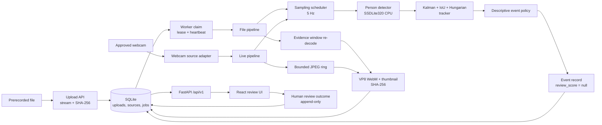

# Architecture

Shop is one local machine, two processes, one SQLite database, and one browser. The API owns HTTP and durable state; the worker owns model inference and evidence generation. No source media or inference result leaves the host.

Provenance labels used in this document: `[Publisher metadata]`, `[Proposed target]`, `[Illustrative assumption]`, `[Actual measured result]`.

## System view

### Process boundaries

| Process | Owns | Must never do |
| --- | --- | --- |
| `uvicorn shop_api.main:app` | HTTP validation, upload receipt, source registration, job creation/cancellation, event/review reads and writes, media streaming, retention/audit endpoints, static UI | Run model inference in a request handler; expose filesystem paths, secrets, or raw exceptions |
| `python -m shop_worker` | Job claim, clocking, inference, tracking, policy, evidence encoding, progress/heartbeats, terminal job writes | Auto-migrate the database; claim beyond configured concurrency; publish an event without evidence status decided |
| Browser | Display, local token/reviewer, explicitly requested media playback | Decide truth, score risk, or fabricate incidents |

The API starts migrations when `storage.auto_migrate` is true. The worker requires an already-migrated schema. If the worker is absent, jobs remain `queued`; `/api/v1/health/ready` reports degraded.

## Processing flow

1. **Ingress.** Uploads stream to a hidden `.part` file, are fsynced, hashed with SHA-256, probed with OpenCV, and atomically renamed. The extension is only a container hint; decoder observations are authoritative. The configured limits are 2 GiB, 2 hours, and 3840×2160 `[Proposed target]`.
2. **Source normalization.** `FileVideoSource` or `WebcamSource` produces a `FrameEnvelope` (`shop_frame_v1`) with integer milliseconds, explicit PTS provenance, monotonic receive time, BGR uint8 pixels, and discontinuity flags.
3. **Cadence.** `SamplingScheduler` accepts only frames at or after the next 5 Hz due timestamp. Early frames are counted as skipped. A decode discontinuity resets cadence and marks the next sample discontinuous.
4. **Detection.** The person detector receives the original BGR frame, resizes internally to 320×320, and returns original-pixel `xyxy` person boxes. A score threshold of 0.50 is a `[Proposed target]`, not a validated operating point.
5. **Tracking.** The local tracker converts boxes to constant-velocity Kalman states, associates with IoU plus elapsed-time motion cost, solves the assignment with Hungarian, and gates implausible jumps. Track IDs are session-local and never identity.
6. **Policy.** `BaselineActivityPolicy` opens a segment on a confirmed observed person, tolerates bounded predicted gaps, splits on long gaps or source discontinuity, emits after the minimum dwell plus a 200 ms sampling tail, and applies cooldown.
7. **Event record.** `EventRecord` carries a null-preserving `review_score`, quality/coverage evidence, model bundle, policy version, and separate evidence status. It has no guilt field.
8. **Evidence.** For files, the source window is re-decoded and annotated; for live sessions, a bounded in-memory JPEG ring is used because no recording exists. A 10 s before/after context is `[Proposed target]`.
9. **Durability.** The worker writes events and evidence rows in SQLite. The API reads them and streams media with HTTP Range support.
10. **Review.** A reviewer chooses `benign`, `review_needed`, or `inconclusive`, with at least one reason code or a note. Corrections append; earlier rows remain visible. The review outcome is stored separately from `review_score` and never rewrites the observation.

## Required contracts

| Contract | Version / shape | Enforcement |
| --- | --- | --- |
| Frame envelope | `shop_frame_v1`; source/session/sequence, integer `pts_ms`, PTS provenance, monotonic receive time, uint8 BGR dimensions, discontinuity | Dataclass validation in `contracts.py`; sources reject mismatched dimensions or negative time |
| Model manifest | `shop_model_manifest_v1`; identity, architecture, weights path/SHA-256/source, preprocessing, outputs, runtime, feature schema, license, approval, evaluation | `registry.inspect_model` verifies hash, role, runtime, and approval; downloads are disabled |
| Event record | Schema `1.0`; UUIDs, integer media interval, reasons, track IDs, nullable score + semantics, quality, evidence lists, model/policy versions, review state | Dataclass + SQLite `CHECK` constraints + API serialization |
| Review | Append-only review row with actor, decision, reason codes, notes, `supersedes_review_id` | API schema + foreign key + event `review_state` update in one transaction |
| Analysis metrics | `actual_measured_result`; analyzed/expected samples, coverage, stage timings, peak RSS, RTF | Computed per run; never copied from publisher metadata |
| Feature schema | `shop_features_v1`; 145 features, 29 samples, 5 Hz, five action classes | Declared in contracts and manifests; temporal model disabled |

Media time is always integer milliseconds relative to the source session. Boxes use finite continuous original-pixel `xyxy` with half-open area semantics; no `+1` pixel area convention. Detection confidence is a model score in `[0,1]`, not a probability that theft occurred.

## Tracking

`PersonTracker` is a local implementation, not a library track manager.

- State: constant-velocity Kalman `[cx, cy, w, h]` with configurable process/measurement noise and initial velocity variance.
- Association cost: `0.6 × IoU cost + 0.4 × elapsed-time motion cost`; weights must sum to 1.0.
- Gating: chi-square-style threshold, plus a hard prediction horizon and larger jump rejection.
- Assignment: Hungarian algorithm over the gated cost matrix.
- Lifecycle: `tentative` after first hits, `confirmed` after the configured hits (3), `lost` when unmatched but still predictable, `removed` after `tracker_remove_after_ms` (2500 ms).
- Discontinuity resets tracking rather than creating a false continuous trajectory.
- IDs such as `t0010` are session-local. They do not identify a customer across cameras or sessions.

Config validation rejects association weights that do not sum to 1.0 and a confirmed prediction horizon shorter than the tentative horizon.

## Descriptive event policy

The baseline policy has one emitted type: `person_activity_observed`, with reason `person_track_observed`.

- Minimum dwell: 4000 ms `[Proposed target]`.
- Gap split: 3000 ms `[Proposed target]`.
- Cooldown: 10 000 ms from the emitted segment end `[Proposed target]`.
- Maximum events per job: 200 `[Proposed target]`.
- A predicted observation can continue a track but does not count as observed time.
- `observed_fraction` and `predicted_gaps` are reported honestly; intermittent tracks add an `intermittent_track_observations` warning.
- The event end is the last observed timestamp plus one sampling interval. Cooldown uses this emitted end, not the raw last observation.
- A source discontinuity closes the current segment before the gap so unrelated media is never presented as one continuous action.
- Quality gates are recorded but do not invent a conviction: low coverage yields reviewable events with explicit warnings or no event, and analysis failures fail closed.

`review_score` stays `null` and `score_semantics` stays `null` because no calibrated model exists. The UI renders "Not scored", never 0.

## Evidence

- **File jobs:** reopen the upload, seek approximately to `start − 3 s`, decode forward, select frames at the analysis cadence, and stop after the requested window. An evidence frame is paired with the nearest sample only when within ~250 ms; otherwise boxes are omitted rather than misaligned.
- **Live jobs:** encode each analysed sample as JPEG once, keep a bounded ring sized to `before + after`, copy shared references into open segment buffers, cap concurrent buffers, and finalize after the event end plus context or at session end.
- **Encoding:** annotate boxes and track labels, encode VP8 WebM at 10 fps, write to a hidden partial file, verify decodability, atomic-rename, write a JPEG thumbnail, compute SHA-256, and persist duration/frame count/encoder/generate time.
- **Failure:** encoder unavailable, empty window, verification failure, or retention disabled yields `evidence.status = unavailable` with a reason. The event remains reviewable.
- **Playback:** API streams only through authorized event media routes. Range requests return 206. Expired/deleted evidence returns an explicit state, not a broken player.

The clip's `start_pts_ms`/`end_pts_ms` describe the retained context window and are returned as `evidence.asset.media_interval_ms`; the event's `media_interval_ms` describes only the observed segment. The UI shows before/after context from these two intervals.

## Storage

SQLite in WAL mode with foreign keys enabled, under `var/shop.db` by default. Tables:

`sources`, `uploads`, `jobs`, `job_transitions`, `events`, `evidence`, `reviews`, `audit`, `idempotency`, plus `alembic_version`.

- Media paths are relative to the storage root and are never returned raw.
- Evidence retention defaults to 7 days; metadata 30 days; audit 90 days `[Proposed target]`. Only evidence expiry is automated in this baseline; metadata/audit limits are declared settings, not enforced jobs.
- Deletion marks a tombstone, removes media, and keeps the event hidden from review. Review history and audit remain.
- Jobs move through `queued → running → completed|failed|cancelled`; `cancelling` is an intermediate request state. CAS transitions guard concurrent changes.
- Interrupted leases are recovered as failed with `WORKER_INTERRUPTED`; the pipeline is not replayed ambiguously.

## API and UI

FastAPI 0.163 on `/api/v1` with Pydantic strict request models. Every request gets a request ID (response header and body). Errors use a stable envelope with a safe message, retryable flag, details, and request ID; unhandled exceptions are logged and never serialized raw.

React 19 + TypeScript + Vite. The built SPA is served by the API with a restrictive Content-Security-Policy. Media is fetched as blobs so native controls work with bearer auth. The design uses Shop navy/teal/canvas/surface tokens, Inter, 44 px controls, and no fabricated incidents.

## Security and privacy

- Bind address is restricted to `127.0.0.1`/`localhost`; RTSP is disabled; audio is disabled by config literal.
- A configured normalized privacy polygon is rasterized before detection, before live preview encoding, and before evidence frames are annotated, so masked pixels never reach the detector or reviewer. An optional analysis ROI filters detections by center. Zone editing is currently configuration-file only.
- Optional bearer auth via `SHOP_API_TOKEN`; no default secret is embedded.
- Reviewer identity comes from `X-Shop-Reviewer` and must match a local allowlist for reviews and mutations.
- Upload filenames are stripped to a safe basename; storage path traversal is rejected; content length and streamed bytes are both bounded.
- No identity recognition, appearance matching, biometric template, or cloud upload exists.
- Absolute paths, tokens, and raw exceptions are excluded from public payloads.

## Failure behavior

| Failure | Behavior |
| --- | --- |
| Camera unavailable/busy | Source health reports disconnected/degraded; live job fails with `CAMERA_DISCONNECTED`; preview returns a safe error |
| Detector load/hash failure | Readiness fails, job creation returns `MODEL_UNAVAILABLE`, capabilities report the reason |
| Detector inference failure | Job fails with `DETECTOR_FAILED`; partial events are flushed but evidence is marked unavailable |
| Storage below reserve | Uploads and job creation return `503 STORAGE_LOW`; readiness fails |
| Evidence encode failure | Event published with `evidence.status = unavailable` and a reason |
| Worker crash | Lease recovery marks the job failed; no silent duplicate inference |
| API crash | Worker may finish an owned job; UI reports unavailable until API returns |
| Schema stale | API migration runs on startup when enabled; worker refuses to invent state |

## Extension gates

Retail detection, pose, TCN, RTSP, appearance matching, exports, and enforcement integrations are separate gates, not toggles. A module is enabled only when all of the following exist: an approved rights decision, a versioned artifact with SHA-256, a frozen input contract, a labelled evaluation split, measured CPU latency, quality/calibration evidence where applicable, and a policy review. The current manifests intentionally fail these gates. See [Models](models.md) and [Status](status.md).
