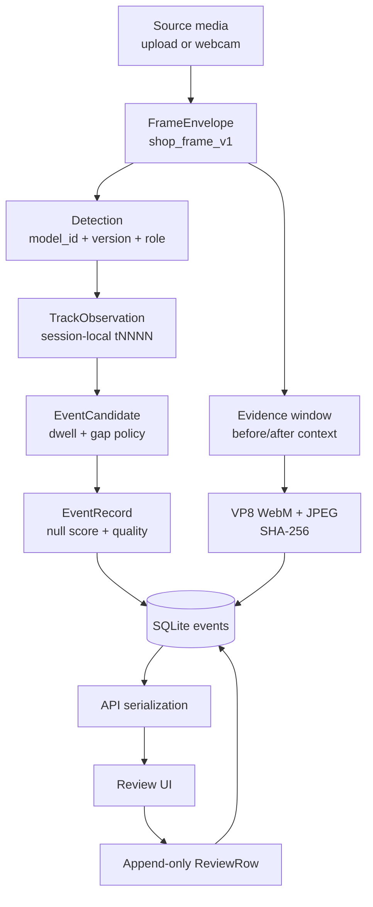

# Data lineage, retention, and rights

Shop keeps one local lineage from source media to a human review outcome. Dataset rights are tracked separately from technical readiness: a file being downloadable does not make it approved for training or commercial use.

Provenance labels: `[Publisher metadata]`, `[Proposed target]`, `[Illustrative assumption]`, `[Actual measured result]`.

## Runtime lineage

### Field-level lineage

| Output | Derived from | Never represents |
| --- | --- | --- |
| `source_id`, `session_id`, `job_id` | Server-created UUIDs, not client authority | A customer or person identity |
| `media_interval_ms` | Analysed sample PTS and policy dwell/gap decisions | Exact wall-clock incident time or full action boundary |
| `track_ids` | Tracker session state (`tNNNN`) | Re-identification across sessions/cameras |
| `review_score` | `null` in the baseline | Risk, probability of theft, or confidence of guilt |
| `score_semantics` | `null` when no calibrated score exists | A semantic label for a number |
| `quality.observed_fraction` | Observed samples / segment samples | Detection recall or video quality score |
| `quality.predicted_gaps` | Tracker-predicted continuity gaps | Missing frames in the whole source |
| `available_evidence` | Actual detector/tracker outputs present | Evidence that was required but absent |
| `evidence.asset.sha256` | Encoded local clip bytes | Source-media hash |
| `review_state` | Latest append-only review decision | Model prediction or ground truth |

Source uploads also store their own SHA-256 and decoder probe. The source hash, event record, clip hash, model bundle, policy version, and review history together form the local audit trail.

## Media and timestamp handling

- Frame PTS is integer milliseconds. Provenance is explicit: `media_pts`, `frame_index_nominal_fps`, or `monotonic_capture`.
- For files, decoded PTS is preferred. If a backend reports zero PTS, the source falls back to nominal frame timing and marks the provenance.
- For webcams, timestamps come from monotonic capture time and are session-relative.
- Sampling is 5 Hz. A frame is analysed only when its PTS reaches the next due time; early frames are skipped, not substituted.
- A detected decode gap or timestamp jump sets `discontinuity`; cadence and tracking reset. Timestamps are never interpolated across a gap.
- Evidence uses the same media timeline as analysis. The retained context window is stored separately from the observed event interval.
- A missing/non-decodable window produces `evidence.status = unavailable` with a reason; no empty clip is published.

## Database schema

SQLite in WAL mode with foreign keys. `var/shop.db`; migrations in `migrations/versions/`.

### `sources`

Registered webcam source; `kind` is `file|webcam|rtsp`, `state` is `idle|active|degraded|disconnected`, `camera_key` must match local approved configuration.

### `uploads`

Owner, safe original filename, relative stored path, SHA-256, bytes, content type, validation status (`validating|ready|rejected|deleted`), decoder probe JSON, created/deleted timestamps. Filenames and paths are never trusted as source truth.

### `jobs`

One file **or** webcam source (database `CHECK`), `queued|running|cancelling|completed|failed|cancelled`, analysis profile, sampling FPS, privacy-mask version, retain-evidence flag, model bundle, policy version, progress/metrics/coverage JSON, safe error code/message, lease owner/expiry, heartbeat, cancel flag, timestamps. `job_transitions` records state changes.

### `events`

Descriptive event segment: job/source/session references, type, reasons, start/end PTS, track IDs, nullable score/semantics/calibration, quality JSON, required/available evidence, model bundle, policy version, schema version, derived review state, evidence status/reason/id, created/deleted timestamps.

Constraints enforce positive interval, non-negative start, score in `[0,1]` or null, valid review and evidence states. There is no theft/guilt column.

### `evidence`

One row per event: relative object and thumbnail paths, SHA-256, bytes, MIME type, dimensions, fps, duration, frame count, context start/end PTS, encoder, generation time, retention deadline, created/deleted timestamps.

### `reviews`

Append-only actor, decision (`benign|review_needed|inconclusive`), reason codes, notes (≤2000 chars), `supersedes_review_id`, timestamp. Corrections insert; rows are never overwritten. `events.review_state` is a derived convenience field updated in the same transaction.

### `audit`

Actor, action, object type/id, request ID, metadata JSON, timestamp. Used for source registration/update, job cancellation, review creation, deletion, and retention actions. Audit retention is separate from evidence retention.

### `idempotency`

Unique `(actor, route, key)`, canonical body hash, stored status/body. Replay returns the stored response; changed body returns 409.

## Retention and deletion

| Data | Default | Mechanism |
| --- | --- | --- |
| Evidence clips/thumbnails | 7 days `[Proposed target]` | `retain_until`; explicit `POST /api/v1/maintenance/retention` |
| Event/job/upload metadata | 30 days `[Proposed target]` | Declared setting; automated metadata expiry is not implemented in this baseline |
| Audit | 90 days `[Proposed target]` | Declared setting; automated audit expiry is not implemented in this baseline |
| Uploads | Until explicit deletion or metadata expiry | 409 while an active job holds the upload |
| Reviews | Append-only; retained with event tombstone | Not edited or silently removed |

`DELETE /events/{id}` removes the media, marks the event deleted, hides it from the queue, and returns a tombstone. Retention maintenance expires due evidence, sets `evidence_status = expired`, keeps the event metadata and review history, and records an audit row. File cleanup failures are counted and reported, not hidden.

No automatic cloud lifecycle or external deletion queue exists.

## Dataset acquisition status

Only one media fixture was downloaded for this build: OpenCV's `vtest.avi`, stored at `var/evaluation/incoming/vtest.avi`.

| Item | Status | Notes |
| --- | --- | --- |
| OpenCV `vtest.avi` | Evaluation fixture only | 768×576, 795 frames, 10 fps, 79.5 s `[Actual measured result]`; no ground-truth theft labels; redistribution/training rights not cleared |
| Own authorized collection | Not present | Required primary commercial source after consent, purpose, and retention approval |
| COCO | Not downloaded for training | Annotation license differs from image rights; images/checkpoint lineage need separate review |
| MEVA | Not downloaded | CC BY 4.0 plus residual rights/release conditions; matched auxiliary pack only after review |
| UCF Crime | Not downloaded | Explicit commercial grant unresolved; quarantine until intended-use permission |
| SKU110K | Not downloaded | Academic noncommercial restriction; no default commercial admission |
| RPC | Not downloaded | CC BY-NC-SA 4.0; separate permission needed |
| D2S | Not downloaded | CC BY-NC-SA 4.0; separate permission needed |
| MOT17 | Not downloaded | CC BY-NC-SA 3.0 and source conditions; separate permission needed |
| Avenue | Not downloaded | Commercial terms unresolved; quarantine |
| ShanghaiTech Campus | Not downloaded | Commercial terms unresolved; quarantine |

These statuses come from the supplied data guide, whose publisher pages were checked on 17 November 2026 `[Publisher metadata]`. Rights clearance is a legal/organisational decision, not something this software can grant.

### Separate data states

Do not collapse these into a single "ready" flag:

1. **Acquired** — bytes exist locally and hashes are recorded.
2. **Technically valid** — decodable, matching labels, expected coverage.
3. **Rights reviewed** — intended use and redistribution permission documented.
4. **Labelled** — annotation version, class map, validity masks, and split group exist.
5. **Evaluation-ready** — frozen, independent test split with ground truth.
6. **Training-approved** — consent/purpose/retention and dataset manifest approved.
7. **Trained** — checkpoint, feature schema hash, calibration, and evaluation report exist.

The current repository has 1–2 only for the OpenCV fixture. No dataset is training-approved, no TCN checkpoint exists, and no retail/product labels exist.

## Training data rules (future)

- Split by recording/session/store before extracting windows or augmentation, so near-duplicate frames cannot leak across train/test.
- Keep a dataset manifest with source, rights decision, consent basis, version, hashes, class map, label validity, and coverage.
- Primary source should be purpose-limited own/authorized footage with consenting adults and documented retention. Public benchmarks are auxiliary only after permission.
- Never infer ground truth from a public benchmark's "test" folder name; verify labels and local scoring support.
- UCF video-level anomaly labels, MOT boxes, and COCO person boxes do not become per-person/per-product theft labels by renaming.
- Balance and calibrate on validation, freeze the test split, and report counts/confidence intervals, not only point estimates.

## Privacy

- Audio is disabled by configuration literal; no audio track is analyzed.
- No face recognition, biometric template, appearance ReID, or customer identity is implemented.
- Person tracks are session-local and are not linked across cameras.
- Uploads, clips, thumbnails, database, and worker heartbeat stay inside `var/` on the local host.
- Configured privacy-mask polygons are applied in preview, detection, and evidence; analysis-ROI centers filter detections. The configuration file is the source of truth; this build has no polygon editor.
- The browser receives media only through authorized event/source routes; API configuration exposes `managed_local_storage`, never an absolute path.
- Human review decisions are operational context, not a finding of guilt or an enforcement record.
