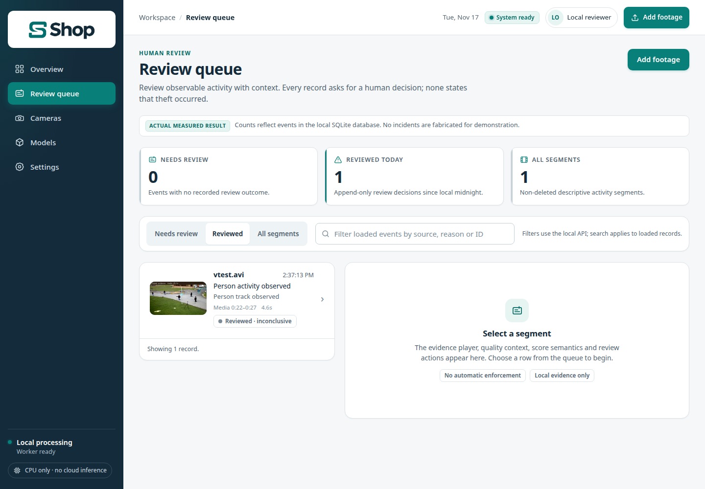
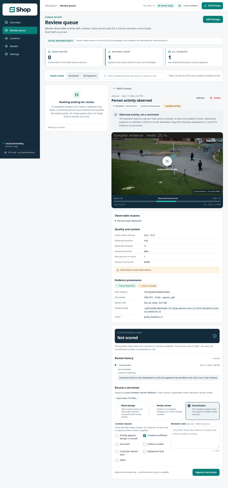
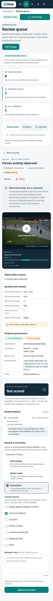

# Evaluation and measured results

This document separates four kinds of numbers:

| Label | Meaning |
| --- | --- |
| `[Publisher metadata]` | Supplied by a model/dataset publisher; not re-measured here |
| `[Proposed target]` | A design goal or acceptance gate; not achieved merely by being written |
| `[Illustrative assumption]` | A starting parameter or explanatory value; requires validation |
| `[Actual measured result]` | Observed on this host during this build |

There is no retail-theft accuracy result, no mAP, no calibration result, and no claim that the baseline detects shoplifting.

## Measured environment

`[Actual measured result]`, from `/api/v1/capabilities`:

| Item | Value |
| --- | --- |
| OS | Linux 7.2.6-76070206-generic x86_64, glibc 2.39 |
| CPU | Intel Core i7-1065G7 @ 1.30 GHz |
| Physical / logical cores | 4 / 8 |
| RAM | 16,133,748 KB (~15.4 GiB) |
| Python | 3.12.3 |
| PyTorch | 2.10.0+cpu |
| TorchVision | 0.25.0+cpu |
| Device | `cpu` |
| CUDA build | `null` |
| CUDA available / devices | false / 0 |
| Inference threads | 4 |
| CPU verification | Passed all six checks |

The CPU verification checks the build (no CUDA), availability, device count, compiled CUDA flag, a real tensor operation on CPU, and the TorchVision `+cpu` suffix. It is not a thermal or sustained-load certification.

## Measured analysis run

Run on 17 November 2026 through the API + worker path, not a synthetic benchmark:

| Field | Value |
| --- | --- |
| Upload | `3b0ed65b-7b33-46ad-bb8e-5c7ef73288d4` |
| Job | `b8e76e74-c00e-4660-afe4-97dccb667e36` |
| Event | `d8ade998-5510-42bf-856c-11962cde081f` |
| Review | `4721608a-bd60-44c9-8d09-4d3d605cbfd4` |
| Source | OpenCV `vtest.avi` |
| Container / codec | AVI / MP43 |
| Resolution | 768×576 |
| Nominal frame rate | 10 fps |
| Frames / duration | 795 / 79,500 ms |
| Analysis cadence | 5 Hz |
| Sampling scheduler | 398 expected, 398 analysed, 0 missing |
| Analysis coverage | 1.0 (100%) |
| Decode gaps | 0 |
| Detection failures | 0 |
| Person detections | 108 |
| Confirmed tracks | 16 |
| Events created | 1 |
| Evidence requested / failed | 1 / 0 |
| Wall time | 41,953 ms |
| Real-time factor | 0.528 |
| Valid analysis throughput | 9.487 analysed samples/s |
| Peak RSS | 612,372 KB (~598 MiB) |

Stage timing, `[Actual measured result]`:

| Stage | Mean | p50 | p95 | Samples |
| --- | --- | --- | --- | --- |
| Decode | 0.839 ms | 0.756 ms | 1.504 ms | 398 |
| Preprocess | 1.189 ms | 1.081 ms | 1.825 ms | 398 |
| Detect | 75.424 ms | 75.126 ms | 113.506 ms | 398 |
| Track | 0.154 ms | 0.076 ms | 0.541 ms | 398 |
| Evidence | 9,746.102 ms | 9,746.102 ms | 9,746.102 ms | 1 |

Interpretation:

- The run finished about 1.9× faster than the media duration on this clip. This is **not** a live-latency guarantee; it is one recorded file on one host/profile.
- Detection dominates per-sample cost. Tracking is a small fraction.
- Evidence generation took ~9.7 s for one 25 s context clip and is reported separately; it happens after analysis and is not part of the 5 Hz per-sample budget.
- Peak RSS includes Torch/TorchVision, the model, decoded frames, and one evidence encode. It is not a memory-leak soak result.
- 108 detections are detection outputs, not 108 people. 16 confirmed tracks are session-local trajectory IDs, not 16 identities.

### The published event

| Field | Value |
| --- | --- |
| Type / reason | `person_activity_observed` / `person_track_observed` |
| Media interval | 22,600–27,200 ms (4.6 s) |
| Track | `t0010` |
| Mean / max person score | 0.5593 / 0.5706 |
| Observed samples | 11 |
| Observed duration | 2,200 ms |
| Observed fraction | 0.4783 |
| Predicted gaps | 17 |
| Max persons in scene | 1 |
| Warning | `intermittent_track_observations` |
| `review_score` | `null` |
| `score_semantics` | `null` |
| Review outcome | `inconclusive` / `context_insufficient` |

The low observed fraction is reported, not hidden. The tracker bridged intermittent detections, so the segment is reviewable but quality-limited. A reviewer note records that this is an evaluation fixture, not a real incident.

### Evidence clip

| Field | Value |
| --- | --- |
| Clip ID | `7cea016d-cca8-4454-84aa-807fe00c5b93` |
| Container / encoder | WebM / VP8 (`opencv_vp8`) |
| Dimensions / fps | 768×576 / 10 fps |
| Duration / frames | 25,200 ms / 252 |
| Bytes | 6,781,987 |
| SHA-256 | `c5d1ba4e923edddc43487ae62892248f9121b7745dc0b277918ad3978343f75f` |
| Context interval | 12,500–37,700 ms |
| Before / after context | 10.1 s / 10.5 s |
| Thumbnail | JPEG, generated from the middle sampled frame |
| Playback check | Browser video `readyState = 4`, duration 25.2 s, 768×576, no media error |

The UI timeline was verified against these values: `Before 10s`, `Observed interval 4.6s`, `After 11s` (10.5 s displayed with rounding), and `clip 0:12–0:37`. This check caught and fixed a serialization gap where the asset's own context interval was not returned; the event interval is not substituted for the clip interval anymore.

## Test results

`[Actual measured result]`, last run on this host:

| Suite | Result |
| --- | --- |
| Backend `pytest tests -q` | **84 passed** |
| Frontend `npm test -- --run` | **54 passed** across 8 files |
| Frontend production build | Passed: 57 modules, 49.32 kB CSS, 373.90 kB JS (9.57 / 112.95 kB gzip) |
| Browser automation | Passed at 1440×1000 and 390×844 |

Backend coverage includes:

- Geometry: box conversion, clipping, IoU, normalized/original transforms.
- Contracts: frame envelope validation, detection role/box constraints, null-preserving event score, feature constants.
- Tracking: Kalman prediction/update, gating, Hungarian association, lifecycle, discontinuity resets, elapsed-time motion.
- Scheduling: strict 5 Hz cadence, early-frame skipping, gap/coverage accounting.
- Privacy zones: polygon rasterization, mask containment, ROI center filtering, and settings validation.
- Policy: minimum dwell, gap split, cooldown from emitted end, discontinuity closure, event cap, null score.
- Registry: manifest schema, hash mismatch, missing artifact, development-only blocking, runtime compatibility, CPU verification.
- Persistence: CAS job transitions, interrupted recovery, idempotency, reviews, retention, evidence tombstones.
- API integration: upload/job/source/event/review/media flows, auth, ETag, error envelope, pagination, deletion, retention, source state derived from active jobs, evidence asset context interval.

Frontend coverage includes: formatting, API auth/error/media URL handling, upload progress/abort/error, common loading/empty/error/modal states, queue filters/search, event detail null score/review append/delete, settings redaction/allowlist/token/retention, and evidence context timeline.

## Browser verification

`[Actual measured result]`. Playwright headless Chromium at desktop 1440×1000 and narrow 390×844:

| Page | Desktop | Narrow 390 px |
| --- | --- | --- |
| Overview | Worker/system state, local-processing copy, no overflow | — |
| Review queue | Empty unreviewed state; reviewed tab shows the real event | No horizontal overflow; reviewed event renders |
| Event detail | "Not scored", null semantics, evidence player, disclaimer | Decision cards stack; review form remains >250 px |
| Upload | Dropzone, audio-disabled copy, recent uploads | Dropzone renders |
| Job | Measured timing and coverage | — |
| Models | Person development-only, retail/pose/temporal disabled | — |
| Cameras | Approved keys, no RTSP copy | — |
| Settings | Managed-storage redaction, reviewer identity, vocabulary | Reviewer panel renders |
| Evidence video | Loaded, `videoError = null` | — |

All interactive controls measured at least 44 px. No horizontal overflow was observed. The only console errors were the intentionally simulated `503` responses used to verify the error state.







The screenshots contain the evaluation fixture and its review note, not a real incident.

## Proposed targets, not achieved results

The supplied ML guide proposes pilot gates. None has been demonstrated by this build:

| Gate | Proposed target | Current status |
| --- | --- | --- |
| Review-policy event recall | ≥ 0.80 | Not measurable: no labelled event test set |
| False alerts | ≤ 0.10 per valid camera-hour | Not measurable: one 79.5 s clip, no benign baseline |
| Coverage | ≥ 0.95 within supported views | 1.0 for this one clip; not a multi-view claim |
| p95 compute availability | ≤ 3 s after required window endpoint | Not measured; file evidence takes ~9.7 s per clip |
| Calibration | Meaningful sample support | No score exists (`null`) |
| Retail detection | Precision/recall/confusion gates | Disabled; no model |
| Pose | CPU feasibility + quality gates | Disabled; no checkpoint |
| Temporal TCN | Event ablation + calibration | Disabled; no trained weights |

Do not turn these into marketing claims. They require an approved, labelled, independent test set; event matching rules; sample counts; and clustered confidence intervals.

## Metric definitions

- **Coverage** = analysed samples / expected samples. It measures cadence completeness, not detection correctness.
- **Real-time factor (RTF)** = wall time / media duration. Lower is faster. It excludes UI time and the initial process/model startup outside the measured job.
- **Valid analysis FPS** = analysed samples / wall seconds. At 5 Hz cadence it can approach or exceed 5 when analysis runs faster than media.
- **Detection mean/p50/p95** = per-sampled-frame detector latency, including preprocessing timing reported separately.
- **Evidence generation** = time to re-decode, annotate, encode, verify, hash, and thumbnail one clip. A single clip yields one sample; p95 is not statistically meaningful.
- **Peak RSS** = process high-water mark from `/proc/self/status`, not system-wide memory pressure.
- **Observed fraction** = observed samples / segment samples. Predicted-only continuity reduces it.
- **Person detections** = raw detector boxes above threshold; not unique people.
- **Confirmed tracks** = trajectories that reached the confirmation hit count; not identities.

## Limitations

- One short evaluation clip, one camera view, one host, one run. No variance study, thermal soak, or sustained multi-hour test.
- No ground-truth person/product/theft labels. Person detection quality is unmeasured (no mAP/precision/recall).
- No retail detector, pose model, TCN, calibration, or event-level accuracy claim.
- Live webcam analysis was implemented and device probing/preview was exercised, but the recorded performance number is from a file. Live queue freshness and camera-specific latency need separate measurement.
- Evidence context is sampled at analysis cadence, not continuous full-frame video. The clip is reviewer context, not a forensic original.
- File evidence is generated after analysis; 9.7 s per clip on this host is not acceptable for every alert at scale and should be queued/budgeted separately.
- The baseline policy's 4 s dwell, 3 s gap split, and 10 s cooldown are proposed settings, not tuned values.
- Browser checks cover layout, states, real media, and accessibility basics (44 px, labels, semantics). They are not a formal WCAG audit with assistive-technology users.
- The in-app browser was unavailable; Playwright headless Chromium was used and is recorded as such.

## Reproduce

```bash
# Start API + worker, then upload the fixture and create a job
curl -s -X POST -F "file=@var/evaluation/incoming/vtest.avi" \
  -H "X-Shop-Reviewer: local-reviewer" \
  http://127.0.0.1:8000/api/v1/uploads

curl -s -X POST http://127.0.0.1:8000/api/v1/jobs \
  -H "Content-Type: application/json" \
  -H "X-Shop-Reviewer: local-reviewer" \
  -H "Idempotency-Key: local-eval-0001" \
  -d '{"source":{"kind":"file","upload_id":"<UPLOAD_ID>"},"analysis_profile":"cpu_baseline_v1","sampling_fps":5,"privacy_mask_version":"zones_default_v1","retain_evidence":true}'

# Inspect measured metrics and event
curl -s http://127.0.0.1:8000/api/v1/jobs/<JOB_ID>
curl -s "http://127.0.0.1:8000/api/v1/events?job_id=<JOB_ID>"
```

Use a fresh database if you want numbers uncontaminated by other local runs. See [Runbook](runbook.md) for reset and backup steps.
